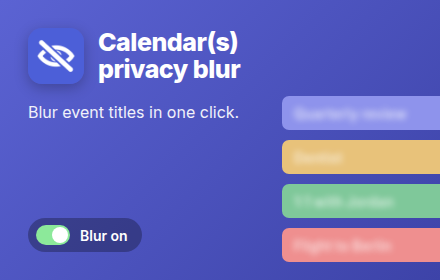
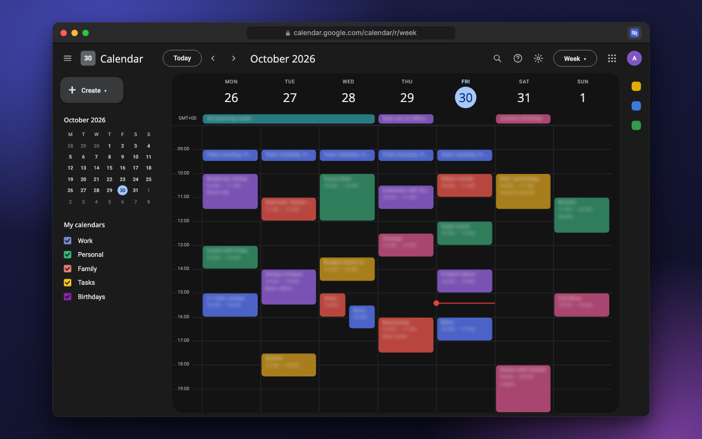
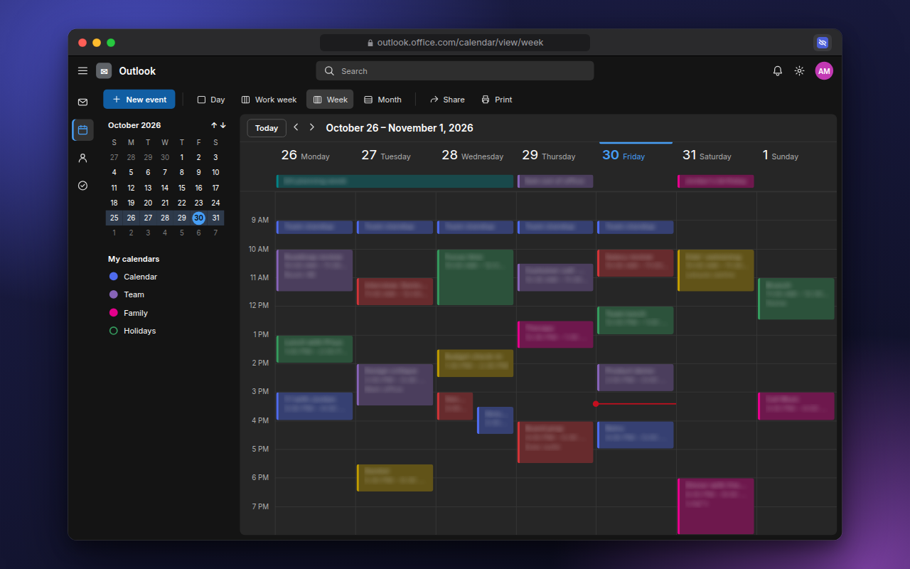
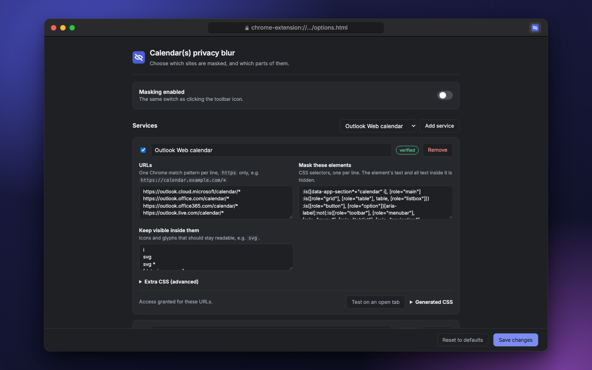

<p align="center">
  
</p>

# Calendar(s) privacy blur

A Manifest V3 Chrome extension that blurs calendar event titles with one click
on the toolbar, so you can share your screen without sharing your schedule.
Google Calendar and Outlook on the web work out of the box; any other web
calendar can be added in Settings.

Grown out of [a DevTools console snippet][gist] that made event text transparent;
this repo turns it into a loadable extension with a real on/off toggle, scoped
selectors that leave the rest of the calendar UI alone, and no network access.

Unofficial, not affiliated with Microsoft or Google.

<table>
  <tr>
    <td width="50%"></td>
    <td width="50%"></td>
  </tr>
  <tr>
    <td align="center"><sub>Google Calendar</sub></td>
    <td align="center"><sub>Outlook on the web</sub></td>
  </tr>
</table>

```
src/      the extension — load this folder unpacked
assets/   Chrome Web Store images, rendered from mock calendars by CI
tools/    icon generator, asset renderer and the selector test fixture
```

**→ [src/README.md](src/README.md)** for what it does, how to load it in
`chrome://extensions`, and the known limitations.

## Chrome Web Store listing

Everything the store's **Store listing** tab asks for, in the order it asks.
Each release also attaches `calendar-privacy-blur-<version>-store-assets.zip`
with every image below and this section's text as `listing.md`.

<!-- listing -->
### Product details

| Field | Value |
| --- | --- |
| Title | `Calendar(s) privacy blur` — from `name` in `src/manifest.json` |
| Summary | `One click blurs event titles in Google Calendar, Outlook on the web and other calendars. Not affiliated with Microsoft or Google.` — from `description` in `src/manifest.json` (132 characters max) |
| Category | Productivity → Workflow & Planning |
| Language | English (United Kingdom) |

**Description** (16,000 characters max; the store shows plain text, so copy it
from the block):

```text
Calendar(s) privacy blur hides the titles of your calendar events with one click, so you can share your screen without sharing your schedule.

Screen-sharing a calendar shows more than you mean to: client names, interview candidates, "Salary review", the doctor's appointment at 3pm. Closing the calendar works, but then you lose your own view of the day.

With blur on, the text of every event turns into a soft smudge. Everything else stays where it was:
• The grid, colours and positions stay put, so you can still see that you're busy, and when.
• Event icons stay visible.
• Toolbars, date navigation and view switchers are never touched.
• Clicking, dragging and creating events work as normal.

HOW IT WORKS
Blur is on as soon as you install. Click the toolbar button to turn it off or on again; the change applies to every open calendar tab instantly, with no reload. An OFF badge on the button shows when titles are visible, so you can check before you start sharing.

WORKS WITH
• Google Calendar
• Outlook on the web (outlook.office.com, outlook.office365.com, outlook.live.com, outlook.cloud.microsoft)
• Any other web calendar you add in Settings: choose the site and which elements to blur.

PRIVACY
• No network requests: no analytics, no tracking, no remote code.
• Nothing from your calendar is stored or sent anywhere. The extension only adds a stylesheet to the page.
• Settings stay in your browser.

This is a visual mask, not encryption. Anyone using your computer can switch it off.

Open source: https://github.com/aleksandrskrivickis/calendar-privacy-blur

Not affiliated with, or endorsed by, Microsoft or Google. Their names are used only to describe which sites the extension works with.
```
<!-- /listing -->

### Graphic assets

Rendered by CI, never edited by hand — see [Store assets](#store-assets).

<table>
  <tr>
    <th>Store icon<br><sub>128 × 128</sub></th>
    <th>Small promo tile<br><sub>440 × 280, 24-bit PNG</sub></th>
  </tr>
  <tr>
    <td align="center"></td>
    <td align="center"></td>
  </tr>
  <tr>
    <th colspan="2">Marquee promo tile <sub>1400 × 560, 24-bit PNG</sub> — shown at the top of this page</th>
  </tr>
</table>

**Screenshots** — 5 of 5 allowed, 1280 × 800, 24-bit PNG:

<table>
  <tr>
    <td width="50%"></td>
    <td width="50%"></td>
  </tr>
  <tr>
    <td align="center"><sub>1 · Google Calendar, before and after</sub></td>
    <td align="center"><sub>2 · Google Calendar, blur on</sub></td>
  </tr>
  <tr>
    <td></td>
    <td></td>
  </tr>
  <tr>
    <td align="center"><sub>3 · Outlook on the web, before and after</sub></td>
    <td align="center"><sub>4 · Outlook on the web, blur on</sub></td>
  </tr>
  <tr>
    <td></td>
    <td></td>
  </tr>
  <tr>
    <td align="center"><sub>5 · Settings</sub></td>
    <td></td>
  </tr>
</table>

Global promo video: none.

<!-- listing -->
### Additional fields

| Field | Value |
| --- | --- |
| Official URL | None — needs a site verified in Google Search Console |
| Homepage URL | https://github.com/aleksandrskrivickis/calendar-privacy-blur |
| Support URL | https://github.com/aleksandrskrivickis/calendar-privacy-blur/issues |
| Mature content | No |
<!-- /listing -->

## Working on it

### Branch naming

```
<prefix>/<NNN>-<kebab-description>
```

| Prefix | For |
| --- | --- |
| `feature/` | new user-facing capability |
| `docs/` | documentation only |
| `refactor/` | internal restructuring, no behaviour change |
| `issue/` | actual issue that can be also tracked by GitHub issue |

`NNN` is zero-padded and increments across the whole repo regardless of prefix,
so branches sort in the order they were started. For `issue/`, use the issue
number instead of the sequence. Keep the description to four words or fewer.

```
feature/001-google-calendar-support
issue/42-all-day-events-unmasked
```

Take the next number from the [closed pull requests](../../pulls?q=is:pr+is:closed)
— each merged branch's number is recorded there. Branches created before this
convention keep their names and don't count toward the sequence.

### Versioning and releases

One workflow, [`release.yml`](.github/workflows/release.yml). When a change
lands on `main` that touches `src/`, it bumps the patch version in
`src/manifest.json`, commits it, and publishes a release with two zips attached:
the extension package to upload, and the store assets (every image above plus
the marked listing sections of this README as `listing.md`).

Chrome refuses an upload that reuses a version, and `chrome://extensions` shows
the version of an unpacked build — so a distinct version per shipped change makes
"which build am I actually running?" answerable at a glance.

It runs on `main` rather than in the pull request, which keeps it serialised:
two merges cannot land on the same version, so nothing has to guard against
duplicates. Changes touching only docs or `tools/` don't bump, since they
don't ship in the extension. Its own commit is marked `[skip release]`.

If a run fails partway — version pushed but no release — re-run it from the
Actions tab. The bump will advance again, which costs nothing but a version
number.

To preview a bump locally without changing anything:

```bash
node tools/bump-version.mjs --dry-run
```

### Store assets

Every image in `assets/` is generated, and committed so pull requests show image
changes side by side. [`render-assets.yml`](.github/workflows/render-assets.yml)
re-renders them on each push to a branch other than `main` that touches `src/`
or the mock pages, and commits the result to that branch.

The screenshots come from mock Google Calendar and Outlook pages that apply the
shipped rules from `src/rules.js`, and from the real settings page — no account
or real data involved. To render locally:

```bash
node tools/render-assets.mjs
```

See [assets/README.md](assets/README.md) for how the mocks work.

### Icons

Regenerate the icons after changing the mark:

```bash
node tools/make-icons.mjs
```

Check the CSS selector against a browser engine without needing an Outlook
account — serve the repo over HTTP and open `tools/selector-fixture.html`. It
reproduces Outlook's ARIA structure and asserts which elements the stylesheet
must mask and which it must leave alone. The stylesheet it tests is generated
from `src/rules.js`, so the fixture always checks what the extension would
actually inject.

## License

GPL-3.0 — see [LICENSE](LICENSE).

[gist]: https://gist.github.com/aleksandrskrivickis/358af3da86d1ca413ff73cb54680fe6b
