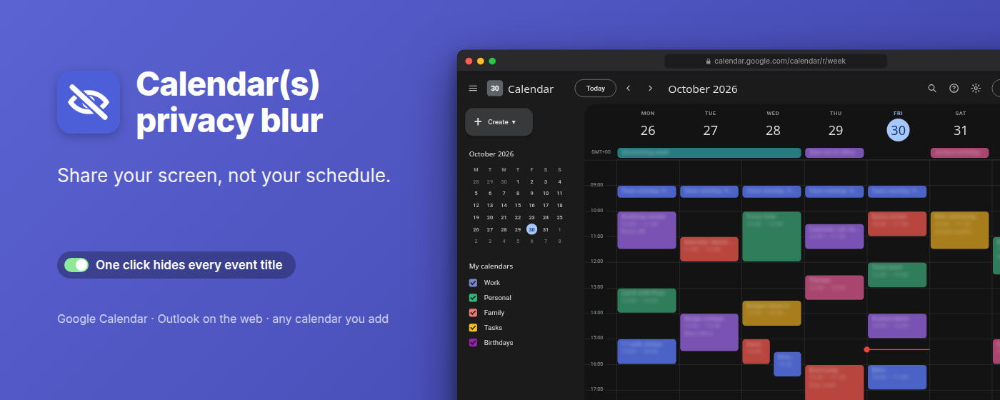
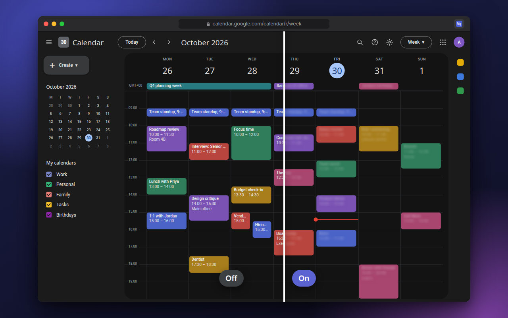
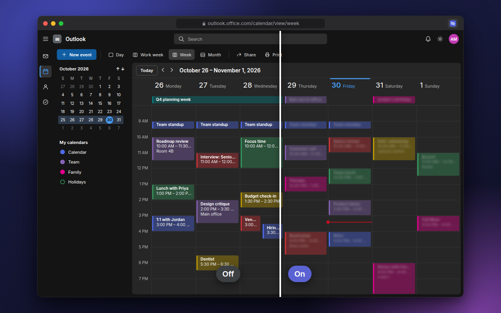

<p align="center">
  
</p>

# Calendar(s) privacy blur

A Manifest V3 Chrome extension that blurs calendar event titles with one click
on the toolbar, so you can share your screen without sharing your schedule.
Google Calendar and Outlook on the web work out of the box; any other web
calendar can be added in Settings.

Grown out of [a DevTools console snippet][gist] that made event text transparent;
this repo turns it into a loadable extension with a real on/off toggle, scoped
selectors that leave the rest of the calendar UI alone, and no network access.

Unofficial, not affiliated with Microsoft or Google.

<table>
  <tr>
    <td width="50%"></td>
    <td width="50%"></td>
  </tr>
  <tr>
    <td align="center"><sub>Google Calendar</sub></td>
    <td align="center"><sub>Outlook on the web</sub></td>
  </tr>
</table>

```
src/      the extension — load this folder unpacked
assets/   Chrome Web Store images, rendered from mock calendars by CI
tools/    icon generator, asset renderer and the selector test fixture
```

**→ [src/README.md](src/README.md)** for what it does, how to load it in
`chrome://extensions`, and the known limitations.

**→ [assets/LISTING.md](assets/LISTING.md)** for the Chrome Web Store listing:
every field, the description and the images.

## Working on it

### Branch naming

```
<prefix>/<NNN>-<kebab-description>
```

| Prefix | For |
| --- | --- |
| `feature/` | new user-facing capability |
| `docs/` | documentation only |
| `refactor/` | internal restructuring, no behaviour change |
| `issue/` | actual issue that can be also tracked by GitHub issue |

`NNN` is zero-padded and increments across the whole repo regardless of prefix,
so branches sort in the order they were started. For `issue/`, use the issue
number instead of the sequence. Keep the description to four words or fewer.

```
feature/001-google-calendar-support
issue/42-all-day-events-unmasked
```

Take the next number from the [closed pull requests](../../pulls?q=is:pr+is:closed)
— each merged branch's number is recorded there. Branches created before this
convention keep their names and don't count toward the sequence.

### Versioning and releases

One workflow, [`release.yml`](.github/workflows/release.yml). When a change
lands on `main` that touches `src/`, it bumps the patch version in
`src/manifest.json`, commits it, and publishes a release with two zips attached:
the extension package to upload, and the store assets
([`assets/LISTING.md`](assets/LISTING.md) with every image it shows).

Chrome refuses an upload that reuses a version, and `chrome://extensions` shows
the version of an unpacked build — so a distinct version per shipped change makes
"which build am I actually running?" answerable at a glance.

It runs on `main` rather than in the pull request, which keeps it serialised:
two merges cannot land on the same version, so nothing has to guard against
duplicates. Changes touching only docs or `tools/` don't bump, since they
don't ship in the extension. Its own commit is marked `[skip release]`.

If a run fails partway — version pushed but no release — re-run it from the
Actions tab. The bump will advance again, which costs nothing but a version
number.

To preview a bump locally without changing anything:

```bash
node tools/bump-version.mjs --dry-run
```

### Store assets

The store images are generated from mock calendars running the shipped code,
and [`render-assets.yml`](.github/workflows/render-assets.yml) commits fresh
ones to any branch whose push touches `src/` or the mocks. To render locally:

```bash
node tools/render-assets.mjs
```

See [assets/README.md](assets/README.md) for how the mocks work.

### Icons

Regenerate the icons after changing the mark:

```bash
node tools/make-icons.mjs
```

Check the CSS selector against a browser engine without needing an Outlook
account — serve the repo over HTTP and open `tools/selector-fixture.html`. It
reproduces Outlook's ARIA structure and asserts which elements the stylesheet
must mask and which it must leave alone. The stylesheet it tests is generated
from `src/rules.js`, so the fixture always checks what the extension would
actually inject.

## License

GPL-3.0 — see [LICENSE](LICENSE).

[gist]: https://gist.github.com/aleksandrskrivickis/358af3da86d1ca413ff73cb54680fe6b
