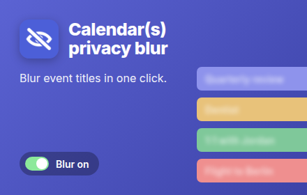
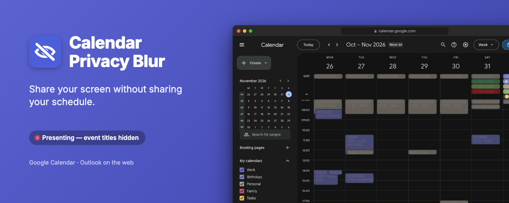
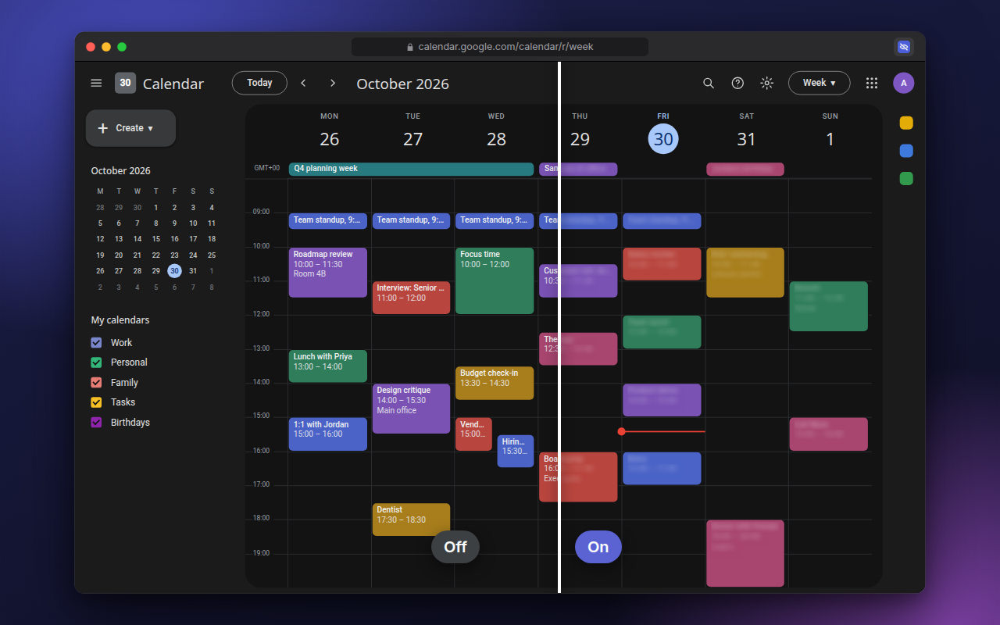
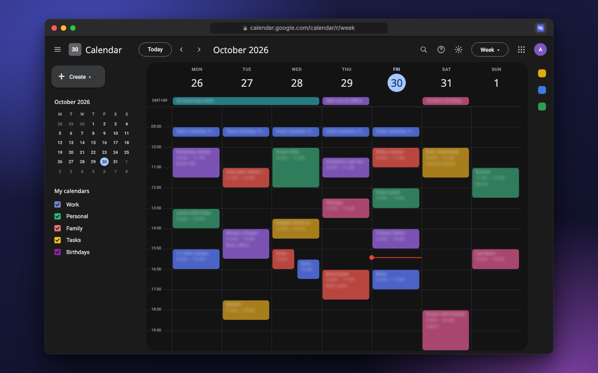
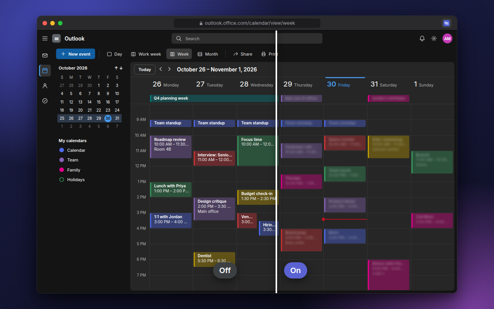
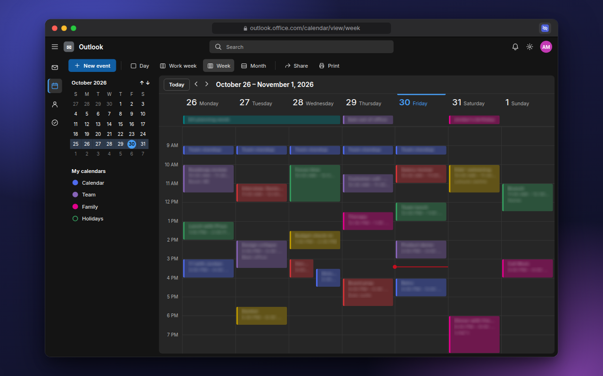
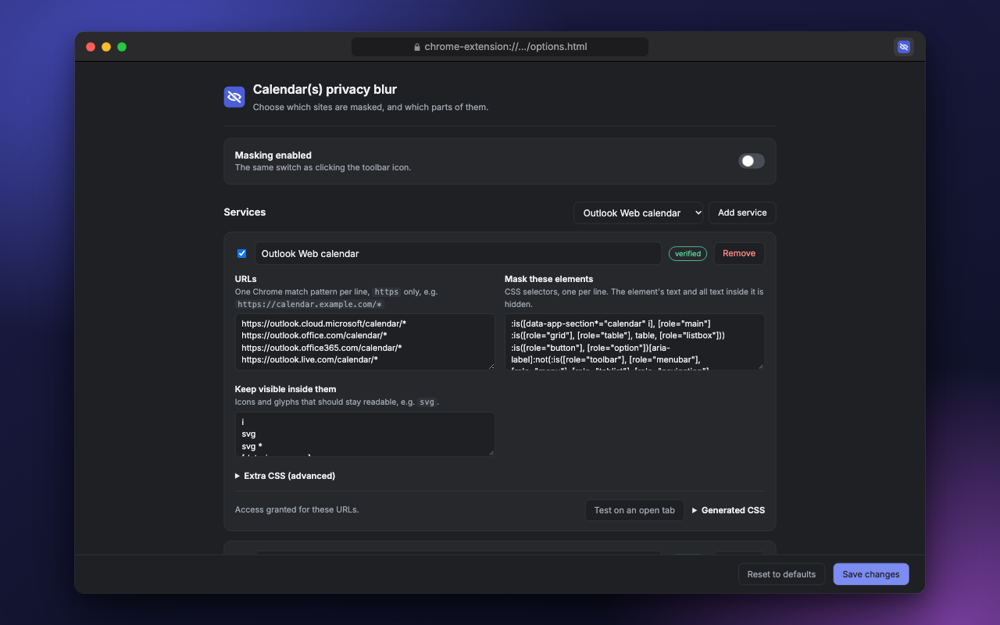

# Chrome Web Store listing

Everything the store's **Store listing** tab asks for, in the order it asks.
Each release attaches `calendar-privacy-blur-<version>-store-assets.zip` with
this file and every image in it, laid out the same way, so the links below work
inside the zip too.

## Product details

| Field | Value |
| --- | --- |
| Title | `Calendar(s) privacy blur` — from `name` in `src/manifest.json` |
| Summary | `One click blurs event titles in Google Calendar, Outlook on the web and other calendars. Not affiliated with Microsoft or Google.` — from `description` in `src/manifest.json` (132 characters max) |
| Category | Productivity → Workflow & Planning |
| Language | English (United Kingdom) |

**Description** (16,000 characters max; the store shows plain text, so copy it
from the block):

```text
Calendar(s) privacy blur hides the titles of your calendar events with one click, so you can share your screen without sharing your schedule.

Screen-sharing a calendar shows more than you mean to: client names, interview candidates, "Salary review", the doctor's appointment at 3pm. Closing the calendar works, but then you lose your own view of the day.

With blur on, the text of every event turns into a soft smudge. Everything else stays where it was:
• The grid, colours and positions stay put, so you can still see that you're busy, and when.
• Event icons stay visible.
• Toolbars, date navigation and view switchers are never touched.
• Clicking, dragging and creating events work as normal.

HOW IT WORKS
Blur is on as soon as you install. Click the toolbar button to turn it off or on again; the change applies to every open calendar tab instantly, with no reload. An OFF badge on the button shows when titles are visible, so you can check before you start sharing.

WORKS WITH
• Google Calendar
• Outlook on the web (outlook.office.com, outlook.office365.com, outlook.live.com, outlook.cloud.microsoft)
• Any other web calendar you add in Settings: choose the site and which elements to blur.

PRIVACY
• No network requests: no analytics, no tracking, no remote code.
• Nothing from your calendar is stored or sent anywhere. The extension only adds a stylesheet to the page.
• Settings stay in your browser.

This is a visual mask, not encryption. Anyone using your computer can switch it off.

Open source: https://github.com/aleksandrskrivickis/calendar-privacy-blur

Not affiliated with, or endorsed by, Microsoft or Google. Their names are used only to describe which sites the extension works with.
```

## Graphic assets

Rendered by CI, never edited by hand — see [README.md](README.md).

<table>
  <tr>
    <th>Store icon<br><sub>128 × 128</sub></th>
    <th>Small promo tile<br><sub>440 × 280, 24-bit PNG</sub></th>
  </tr>
  <tr>
    <td align="center"></td>
    <td align="center"></td>
  </tr>
</table>

**Marquee promo tile** — 1400 × 560, 24-bit PNG:



**Screenshots** — 5 of 5 allowed, 1280 × 800, 24-bit PNG:

<table>
  <tr>
    <td width="50%"></td>
    <td width="50%"></td>
  </tr>
  <tr>
    <td align="center"><sub>1 · Google Calendar, before and after</sub></td>
    <td align="center"><sub>2 · Google Calendar, blur on</sub></td>
  </tr>
  <tr>
    <td></td>
    <td></td>
  </tr>
  <tr>
    <td align="center"><sub>3 · Outlook on the web, before and after</sub></td>
    <td align="center"><sub>4 · Outlook on the web, blur on</sub></td>
  </tr>
  <tr>
    <td></td>
    <td></td>
  </tr>
  <tr>
    <td align="center"><sub>5 · Settings</sub></td>
    <td></td>
  </tr>
</table>

Global promo video: none.

## Additional fields

| Field | Value |
| --- | --- |
| Official URL | https://aleksandrskrivickis.github.io/calendar-privacy-blur/ — once verified in Google Search Console |
| Homepage URL | https://aleksandrskrivickis.github.io/calendar-privacy-blur/ |
| Support URL | https://github.com/aleksandrskrivickis/calendar-privacy-blur/issues |
| Mature content | No |
| Privacy policy URL (Privacy tab) | https://aleksandrskrivickis.github.io/calendar-privacy-blur/privacy.html |
